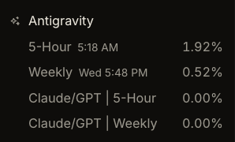

# Antigravity Usage for OpenChamber

Live Antigravity CLI (`agy`) quota tracking inside OpenChamber's native **Usage** and **Work Status** panels — without OAuth plugins, token scraping, or ACP dependencies.



## Why This Exists

- **Works standalone:** Requires only the official `agy` CLI — no `opencode-antigravity-acp` or third-party OAuth plugin needed.
- **Two-decimal precision:** Reads exact `remaining_fraction` values from `agy -p /usage --output-format json` instead of rounded text output.
- **Native OpenChamber UI:** Reports numeric `usedPercent` so OpenChamber's built-in color thresholds apply automatically (`50%+` warning, `80%+` error).
- **Safe reset handling:** Converts invalid `1970` epoch reset timestamps (reported for Claude/GPT windows) to `null` (unknown).

## Requirements

| Requirement | Details |
| --- | --- |
| **OpenChamber** | `>= 2.7.0` (runs the pre-built `service/main.js` host bundle; no Node/Bun needed for end users) |
| **Antigravity CLI (`agy`)** | Installed in `~/.local/bin/agy`, `/opt/homebrew/bin/agy`, `/usr/local/bin/agy`, or on `PATH` |
| **CLI Auth** | Signed in (`agy -p /usage` works in your terminal) |

## Quick Start

1. **Clone** the repository:
   ```bash
   git clone https://github.com/omkardamame/openchamber-antigravity-usage.git
   ```
2. **Add extension** in OpenChamber: **Settings → Extensions** → select the cloned folder.
3. **Approve permission** when prompted (`exec: ["agy"]`).
4. **Enable provider** under **Settings → Usage** / **Work Status**.

## Architecture & Security

```text
OpenChamber Host ──(POST /quota, Bearer token)──▶ service/main.js (127.0.0.1)
                                                        │
                                                        ▼ execFile (no shell, allowlisted env)
                                                   agy -p /usage --output-format json
```

- **Auth:** Constant-time Bearer token verification (`timingSafeEqual`) on `/health` and `/quota`.
- **Process isolation:** Invokes `agy` directly via `execFile` (no shell interpolation) with an allowlisted environment (`HOME`, `PATH`, `LANG`, `LC_ALL`, `TMPDIR`, `USER`) so `OPENCHAMBER_SERVICE_TOKEN` never leaks to child processes.
- **Resilience:** Coalesces concurrent `/quota` requests, caches the resolved `agy` binary path (invalidating on `ENOENT`), enforces an `18s` CLI timeout (under OpenChamber's `20s` quota deadline) and `64 KB` max request body, and fails closed on malformed JSON.

## Project Layout

- `package.json` — OpenChamber extension manifest (`apiVersion: 1`, `provides: ["quota"]`)
- `service/src/main.js` — HTTP server (`/health`, `/quota`) and graceful shutdown
- `service/src/quota.js` — `agy` discovery, minimal-env execution, and strict JSON parser
- `service/main.js` — Pre-built Node bundle for OpenChamber's host runtime
- `scripts/quota-test.mjs` — Unit & HTTP handler tests (`node --test`)
- `scripts/verify.sh` — Full verification gate (build, manifest check, tests, secret scan, changelog)

## Development

```bash
npm install
npm test      # Run full verification gate (build, check, tests, secret scan, changelog)
npm run build # Rebuild service/main.js via openchamber-guest-bundle
```

## Policy Notice

Google states that wrapping `agy` in third-party applications is unsupported under consumer plans. This extension executes the official `agy` CLI locally; use at your own discretion.

## License

[MIT](LICENSE) © 2026 Omkar Damame
